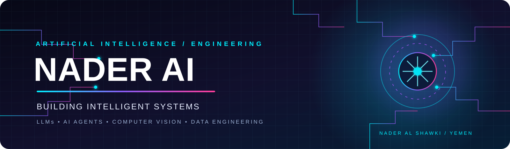
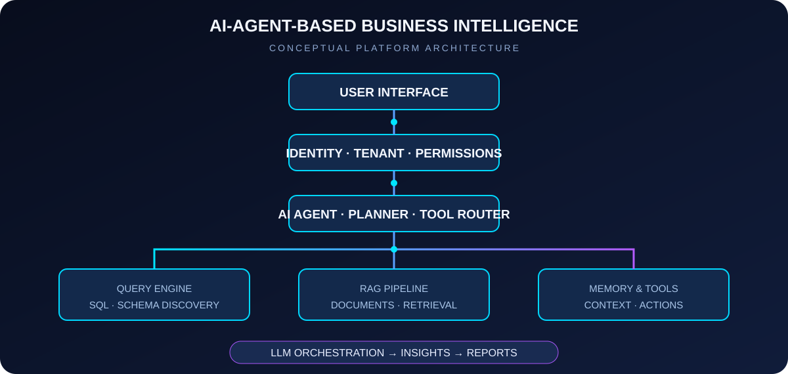

 

### AI Engineer in Progress · Big Data · Intelligent Systems · Applied AI

**Al-Razi University** · Sana'a, Yemen 🇾🇪

[GitHub](https://github.com/Naderalshawki) · [LinkedIn](https://www.linkedin.com/in/nader-al-shawky/) · [Email](mailto:naderalshawki@gmail.com)

---

## `01` / PROFESSIONAL PROFILE

**Nader Al Shawki** — Artificial Intelligence student and developer interested in building practical intelligent systems across AI, data engineering, computer vision, mobile applications, and connected devices.

My work and learning combine software engineering foundations with applied AI:

- 🎓 Studying Artificial Intelligence at **Al-Razi University**.
- 🚀 Built a distributed ELT pipeline designed to process **30M+ records (~12.65 GB)** using PySpark, with schema validation, data-quality rules, anomaly quarantine, and idempotent loading.
- 🤖 Developing an **AI-Agent-Based Business Intelligence Platform** combining LLMs, RAG, schema intelligence, natural-language database querying, and document understanding.
- 👁️ Exploring computer-vision systems using YOLOv8, PyTorch, and OpenCV.
- 📱 Building cross-platform mobile applications with Flutter and Dart.
- ⚡ Exploring Edge AI and embedded IoT concepts using ESP32, Arduino, and MQTT.
- 📊 Creating analytical data models and dashboards with Power BI and DAX.

> **Engineering principle:** Understand the problem. Design the system. Build it. Test it. Improve it.

---

## `02` / ENGINEERING DOMAINS

<table>
<tr>
<td width="50%" valign="top">

### 🤖 Generative AI & Agentic Systems

- Large Language Models (LLMs)
- Retrieval-Augmented Generation (RAG)
- AI Agents and Multi-Agent Workflows
- Prompt Engineering
- LangChain and Tool Orchestration
- Text-to-SQL and Schema Intelligence

</td>
<td width="50%" valign="top">

### 📊 Big Data & Data Engineering

- Python and PySpark
- Distributed ELT Pipelines
- Data Validation and Quality Rules
- Schema Design and Data Processing
- SQL and Relational Databases
- Power BI and DAX

</td>
</tr>
<tr>
<td width="50%" valign="top">

### 👁️ AI, Vision & Deep Learning

- PyTorch and TensorFlow
- YOLOv8 and Object Detection
- OpenCV and Image Processing
- CNNs and Image Classification
- Explainable AI exploration
- NLP fundamentals

</td>
<td width="50%" valign="top">

### 📱 Software, Mobile & Connected Systems

- Flutter and Dart
- Firebase and REST APIs
- FastAPI and Docker
- ESP32 and Arduino
- MQTT and IoT concepts
- Git, GitHub and testing

</td>
</tr>
</table>

---

## `03` / TECHNOLOGY STACK

### Languages & Core Development

### Big Data & Analytics

### Mobile & Application Architecture

### AI, Vision & Deep Learning

### Edge, IoT & Embedded Systems

### Backend, Deployment & Developer Tools

---

## `04` / FEATURED ENGINEERING PROJECTS

### 01. ⚡ Distributed Big Data ELT Pipeline — 30M+ Records

> **Stack:** `PySpark` · `Python` · `MongoDB` · `PyTest` · `Distributed Systems`

- Built a distributed ingestion pipeline designed to process **30M+ rows (~12.65 GB)**.
- Implemented schema validation and eight automated data-quality rules.
- Added anomaly quarantine routing for invalid or suspicious records.
- Designed idempotent upsert logic to prevent duplicate loading and preserve data consistency.

**Repository:** [midterm-data-pipeline](https://github.com/Naderalshawki/midterm-data-pipeline)

---

### 02. 📱 Cross-Platform E-Commerce Mobile Application

> **Stack:** `Flutter` · `Dart` · `Firebase` · `REST APIs` · `BLoC / Provider`

- Developed a cross-platform mobile application using Flutter and Dart.
- Worked on modular application architecture, product catalogs, and API integration.
- Focused on responsive interfaces, state management, offline behavior, and automated testing.

---

### 03. 🌐 Edge AI & IoT Surveillance Hub

> **Stack:** `ESP32` · `Arduino` · `MQTT` · `OpenCV` · `FastAPI`

- Designed an embedded sensor-network concept using ESP32 microcontrollers and MQTT messaging.
- Explored edge computer-vision workflows for occupancy and motion detection.
- Connected sensor telemetry with APIs and dashboard-oriented data flows.

---

### 04. 🍅 Agricultural Plant Disease Detection API

> **Stack:** `YOLOv8` · `PyTorch` · `FastAPI` · `Docker` · `Computer Vision`

- Developed a computer-vision workflow for identifying plant-leaf disease categories.
- Worked with object-detection and classification approaches.
- Organized inference behind FastAPI endpoints for application integration.

**Repository:** [Tomato-Leaf-Disease-Detection](https://github.com/Naderalshawki/Tomato-Leaf-Disease-Detection)

---

### 05. 🫁 Pneumonia Detection from Chest X-rays

> **Stack:** `Deep Learning` · `CNN` · `PyTorch` · `Medical Imaging`

- Worked on deep-learning models for chest X-ray image classification.
- Explored Grad-CAM heatmaps to visualize image regions influencing model predictions.
- Focused on model evaluation and explainability in medical-imaging experiments.

---

### 06. 😀 Real-Time Facial Expression & Demographic Vision

> **Stack:** `OpenCV` · `Python` · `Deep Learning` · `Computer Vision`

- Explored real-time video-processing workflows for face-related visual analysis.
- Worked with emotion-estimation and age-range estimation concepts.
- Focused on inference workflow design and local processing.

---

### 07. 📊 Sales & Profitability Business Intelligence Dashboard

> **Stack:** `Power BI` · `DAX` · `Data Modeling` · `ETL`

- Designed analytical data models for sales and profitability reporting.
- Worked with KPI calculations, cohort-style analysis, and interactive dashboard concepts.
- Used DAX measures to support business analysis and reporting.

---

## `05` / ENTERPRISE AI BUSINESS INTELLIGENCE

A major ongoing direction: an **AI-Agent-Based Business Intelligence Platform for Analyzing Databases and Documents**.

The platform aims to let users ask questions in natural language and receive grounded answers from structured data and business documents.

**Core architecture areas:**

- **Identity & Tenant Layer:** user identity, tenant isolation, and permissions.
- **AI Agent & Planner:** intent understanding, planning, and tool selection.
- **Schema & Query Engine:** database schema discovery and controlled Text-to-SQL workflows.
- **RAG & Document Intelligence:** document ingestion, chunking, embeddings, retrieval, and grounded answers.
- **Memory & Tools:** conversation context and specialized tool execution.
- **Insights & Reports:** analytical explanations and structured reporting.

**Data-platform direction:** PostgreSQL / Supabase, with support planned for relational sources such as MySQL, SQL Server, and SQLite.  
**Note:** MongoDB belongs to the separate distributed data-pipeline project above, not this platform's stated final architecture.

**Repository:** [Enterprise_AI_BI_Platform](https://github.com/Naderalshawki/Enterprise_AI_BI_Platform)

---

## `06` / CS50 — INTRODUCTION TO AI WITH PYTHON

Completed all **12 projects** from Harvard University's CS50's Introduction to Artificial Intelligence with Python.

| # | Project | Main concepts |
|:--:|---|---|
| 01 | [Degrees](https://github.com/Naderalshawki/CS50-AI-Projects/tree/main/degrees) | Graph Search · BFS |
| 02 | [Tic-Tac-Toe](https://github.com/Naderalshawki/CS50-AI-Projects/tree/main/tictactoe) | Minimax · Adversarial Search |
| 03 | [Knights](https://github.com/Naderalshawki/CS50-AI-Projects/tree/main/knights) | Propositional Logic |
| 04 | [Minesweeper](https://github.com/Naderalshawki/CS50-AI-Projects/tree/main/minesweeper) | Knowledge Representation · Inference |
| 05 | [PageRank](https://github.com/Naderalshawki/CS50-AI-Projects/tree/main/pagerank) | Probability · Random Surfer |
| 06 | [Heredity](https://github.com/Naderalshawki/CS50-AI-Projects/tree/main/heredity) | Bayesian Networks |
| 07 | [Crossword](https://github.com/Naderalshawki/CS50-AI-Projects/tree/main/crossword) | Constraint Satisfaction |
| 08 | [Shopping](https://github.com/Naderalshawki/CS50-AI-Projects/tree/main/shopping) | Machine Learning · Classification |
| 09 | [Nim](https://github.com/Naderalshawki/CS50-AI-Projects/tree/main/nim) | Reinforcement Learning · Q-Learning |
| 10 | [Traffic](https://github.com/Naderalshawki/CS50-AI-Projects/tree/main/traffic) | CNN · Image Classification |
| 11 | [Parser](https://github.com/Naderalshawki/CS50-AI-Projects/tree/main/parser) | NLP · Context-Free Grammars |
| 12 | [Attention](https://github.com/Naderalshawki/CS50-AI-Projects/tree/main/attention) | Transformers · BERT · Attention |

---

## `07` / GITHUB ACHIEVEMENTS & ANALYTICS

  

  

  

---

## `08` / CONNECT

**Open to learning, technical discussions, and meaningful collaboration.**

  

### LEARN CONTINUOUSLY · BUILD THOUGHTFULLY · INNOVATE RESPONSIBLY

Designed and maintained by Nader Al Shawki · NADER AI

