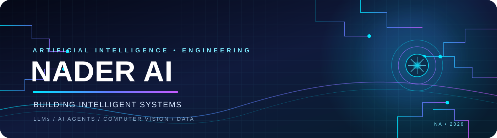

 

**AI Engineering Student · AI Developer · Intelligent Systems**

Al-Razi University · Sana'a, Yemen 🇾🇪

---

## ◈ 01 / ABOUT

I'm **Nader Al Shawki**, an Artificial Intelligence student at **Al-Razi University**. I enjoy turning technical ideas into practical software and exploring how intelligent systems can solve real-world problems.

My current areas of focus:

- **Generative AI:** LLMs, Retrieval-Augmented Generation (RAG), prompt engineering, and AI agents.
- **Computer Vision:** image classification, object detection, YOLO, PyTorch, and OpenCV.
- **Data Engineering:** Python, ETL workflows, PySpark, SQL, and data quality.
- **Backend Development:** FastAPI, REST APIs, database integration, and system design.
- **Application Development:** Flutter, Dart, and cross-platform applications.
- **Business Intelligence:** Power BI, data modeling, and DAX.

> **MISSION** — Build useful, reliable, and thoughtfully engineered intelligent systems.

## ◈ 02 / TECHNOLOGY

**AI & MACHINE LEARNING**

**LLMs · RAG · AI AGENTS**

**DATA ENGINEERING & BI**

**BACKEND · MOBILE · DEV TOOLS**

---

## ◈ 03 / SELECTED WORK

<table>
<tr>
<td width="50%" valign="top">

### 🤖 Enterprise AI Business Intelligence Platform

An AI-agent-based BI platform designed to connect structured databases and business documents through natural-language interaction.

**Core:** LLMs · AI Agents · RAG · Text-to-SQL · PostgreSQL · FastAPI

</td>
<td width="50%" valign="top">

### ⚡ Distributed Data Pipeline

A data engineering project focused on distributed ELT processing, schema validation, data-quality checks, anomaly handling, and reliable loading.

**Core:** Python · PySpark · ELT · Data Quality · Testing

</td>
</tr>
<tr>
<td width="50%" valign="top">

### 🧠 CS50 — Introduction to AI with Python

Completed all twelve course projects, covering search, logic, probability, machine learning, neural networks, and NLP.

**Core:** Python · Search · ML · NLP · Neural Networks

 

</td>
<td width="50%" valign="top">

### 🍅 Tomato Leaf Disease Detection

A computer-vision project exploring deep-learning-based plant leaf disease detection and practical model deployment.

**Core:** Python · YOLOv8 · Computer Vision · FastAPI

</td>
</tr>
</table>

---

## ◈ 04 / CS50 AI — 12 PROJECTS COMPLETED

I completed the twelve projects in **CS50's Introduction to Artificial Intelligence with Python**.

| # | Project | Concepts |
|:--:|---|---|
| 01 | [Degrees](https://github.com/Naderalshawki/CS50-AI-Projects/tree/main/degrees) | Graph Search · BFS |
| 02 | [Tic-Tac-Toe](https://github.com/Naderalshawki/CS50-AI-Projects/tree/main/tictactoe) | Minimax · Adversarial Search |
| 03 | [Knights](https://github.com/Naderalshawki/CS50-AI-Projects/tree/main/knights) | Propositional Logic |
| 04 | [Minesweeper](https://github.com/Naderalshawki/CS50-AI-Projects/tree/main/minesweeper) | Logical Inference |
| 05 | [PageRank](https://github.com/Naderalshawki/CS50-AI-Projects/tree/main/pagerank) | Probability · Random Surfer |
| 06 | [Heredity](https://github.com/Naderalshawki/CS50-AI-Projects/tree/main/heredity) | Bayesian Networks |
| 07 | [Crossword](https://github.com/Naderalshawki/CS50-AI-Projects/tree/main/crossword) | Constraint Satisfaction |
| 08 | [Shopping](https://github.com/Naderalshawki/CS50-AI-Projects/tree/main/shopping) | Machine Learning |
| 09 | [Nim](https://github.com/Naderalshawki/CS50-AI-Projects/tree/main/nim) | Reinforcement Learning |
| 10 | [Traffic](https://github.com/Naderalshawki/CS50-AI-Projects/tree/main/traffic) | CNN · Image Classification |
| 11 | [Parser](https://github.com/Naderalshawki/CS50-AI-Projects/tree/main/parser) | NLP · Context-Free Grammars |
| 12 | [Attention](https://github.com/Naderalshawki/CS50-AI-Projects/tree/main/attention) | Transformers · BERT |

---

## ◈ 05 / GITHUB ACTIVITY

  

  

---

## ◈ 06 / CONNECT

Interested in AI, intelligent applications, and meaningful engineering collaboration? Let's connect.

  

**LEARN CONTINUOUSLY · BUILD THOUGHTFULLY · INNOVATE RESPONSIBLY**

Designed by Nader Al Shawki · NADER AI

